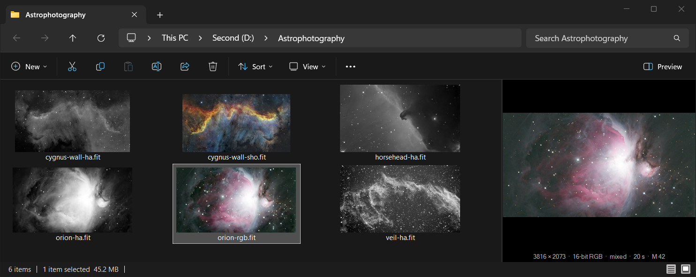
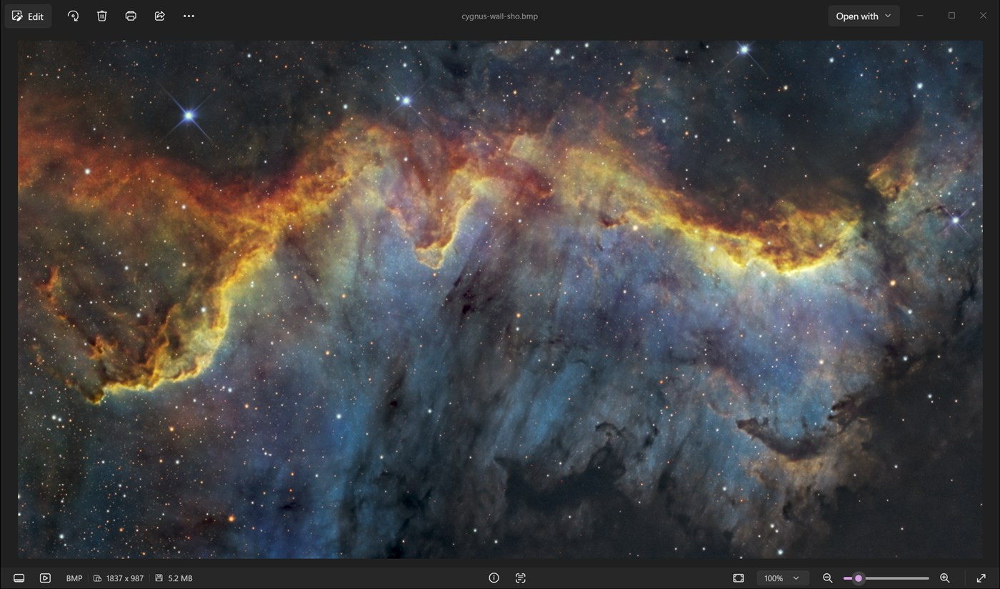

# FITS Viewer

[](https://github.com/Sam-de-Ham/fits-viewer/actions/workflows/ci.yml)
[](https://github.com/Sam-de-Ham/fits-viewer/releases/latest)
[](LICENSE)

See your FITS astrophotography files in Windows: thumbnails in File Explorer, a preview pane,
and full-size viewing in Windows Photo Viewer or Photos. Raw linear frames are automatically
stretched, so they look like they do in your processing software instead of a black rectangle.





## Features

- **Thumbnails** in every File Explorer icon view
- **Preview pane** (Alt+P) with size, sample type, filter, exposure and target
- **Windows Photo Viewer**, Paint and other apps built on Windows Imaging Component open FITS
  files at full resolution
- **Windows Photos** via *Open with → Photos (FITS)*
- Mono, RGB and one-shot-color (Bayer) images; 8 to 64-bit integer and floating-point data
- A single ~280 KB DLL. Nothing runs in the background, and it makes no network connections.

## Install

1. Download the zip from the [latest release](https://github.com/Sam-de-Ham/fits-viewer/releases/latest)
   and extract it.
2. Right-click `install.ps1` → **Run with PowerShell**, and accept the administrator prompt.

Then open a folder of FITS files and choose *View → Large icons*. Press Alt+P for the preview
pane, or right-click a file → *Open with* → *Windows Photo Viewer* (arrow keys step through the
folder) or *Photos (FITS)*. Installing does not change which app opens FITS files on
double-click; tick *Always* in the *Open with* dialog if you want it to.

To remove it, run `uninstall.ps1` the same way.

Requires 64-bit Windows 10 or 11.

### What the installer changes

It copies `fits_viewer.dll` to `C:\Program Files\FITS Viewer` and registers it for `.fits`,
`.fit` and `.fts` files: a thumbnail provider, a preview handler, an image decoder and two
*Open with* entries. All registry entries are listed in [`src/registry.rs`](src/registry.rs),
and `uninstall.ps1` removes them again.

Release zips are built from the tagged source by GitHub Actions, with a signed
[build provenance attestation](https://docs.github.com/en/actions/security-for-github-actions/using-artifact-attestations).
To check that a download was built from this repository:

```
gh attestation verify fits-viewer-v1.0.0.zip --repo Sam-de-Ham/fits-viewer
```

## Troubleshooting

- **Thumbnails don't appear:** sign out and back in, or restart Explorer from Task Manager.
  Windows caches thumbnails, so files it has already shown without one may need *Disk Cleanup →
  Thumbnails* once.
- **Preview pane says the file "could harm your computer":** Windows blocks previews of files
  downloaded from the internet. Right-click the file → *Properties* → *Unblock*.

## Supported files

- Mono images, RGB cubes (`NAXIS3 = 3`) and one-shot-color frames (`BAYERPAT`, with
  `XBAYROFF`/`YBAYROFF`), debayered by binning each 2×2 cell into one pixel
- `BITPIX` 8, 16, 32, 64, -32 and -64, with `BZERO`/`BSCALE`
- `ROWORDER = 'TOP-DOWN'` as written by N.I.N.A. and others; bottom-up otherwise, per the FITS
  standard
- Images in the primary unit or the first image extension

Compressed files (`.fz`) are not supported.

## How it works

Every integration shares one pipeline:

1. **Decode** ([`fits.rs`](src/fits.rs)): the file is read once, and rows are averaged into the
   output size as they stream in, so memory use stays small even for large stacks. A spread-out
   sample of the original pixels is kept alongside for statistics.
2. **Stretch** ([`stretch.rs`](src/stretch.rs)): per channel, the background median and noise
   (MAD) are measured on those full-resolution samples, the black point is set just below the
   background, and a midtones curve lifts the background to 25% grey, as in PixInsight's
   AutoSTF. Because the statistics don't depend on the output size, a thumbnail and the
   full-size view get the same stretch.
3. **Present** the 8-bit result through the matching Windows interface:

| Module | Interface | Used by |
|---|---|---|
| [`thumbnail.rs`](src/thumbnail.rs) | `IThumbnailProvider` | File Explorer thumbnails |
| [`preview.rs`](src/preview.rs) | `IPreviewHandler` | File Explorer preview pane |
| [`wic.rs`](src/wic.rs) | `IWICBitmapDecoder` | Photo Viewer, Paint and other WIC apps |
| [`photos.rs`](src/photos.rs) | `rundll32` entry point | Photos, via a temporary BMP |

The Photos app only opens file types built into it, so *Photos (FITS)* renders the image to
`%TEMP%\FitsViewer` (cleared after a day) and opens that copy.

## Building from source

Requires the [Rust toolchain](https://rustup.rs) with the MSVC target.

```powershell
cargo build --release
.\install.ps1
cargo test --release
cargo run --release --example render -- input.fits output.bmp 512
```

`install.ps1` picks up the DLL from `target\release`. The tests create FITS files in memory and
drive the COM objects through the same interfaces Windows uses, without installing anything. The
`render` example writes a file's stretched rendering to a BMP.

## License

[MIT](LICENSE)
